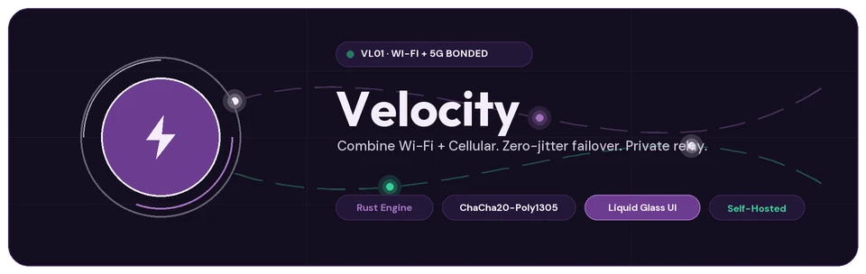
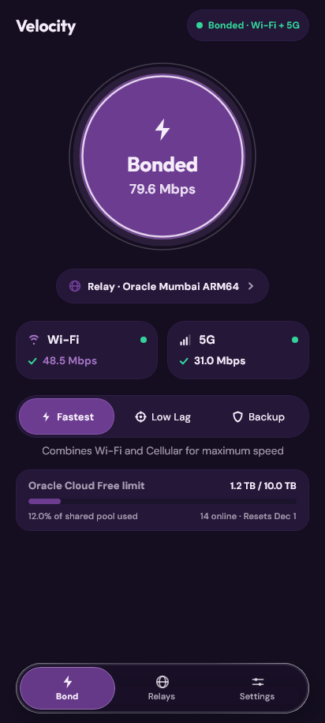
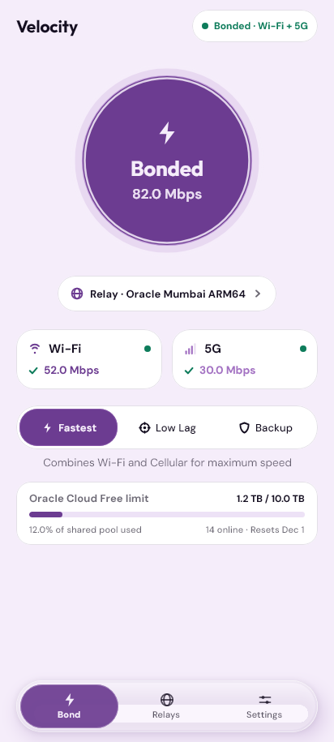
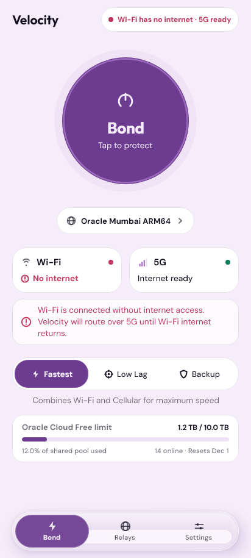
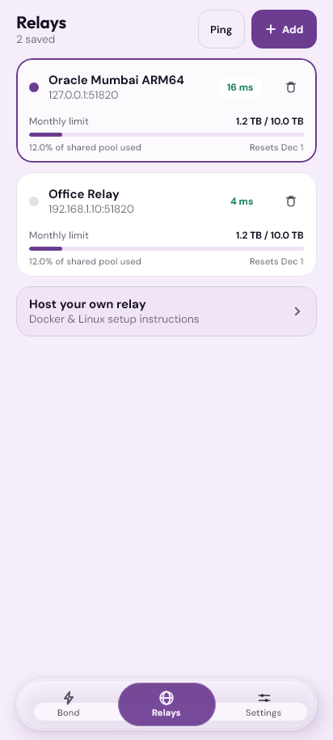
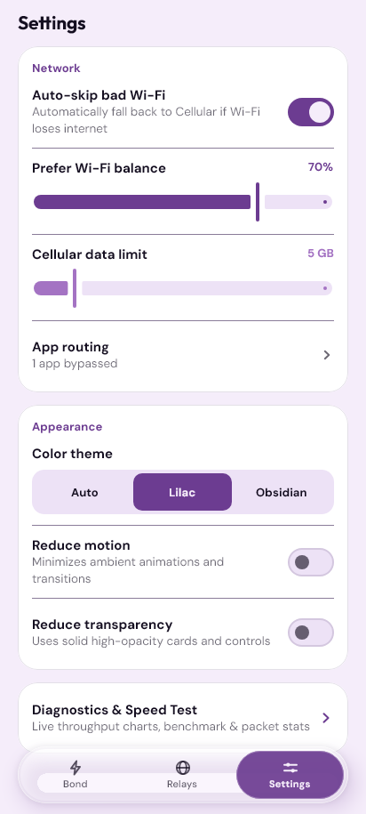
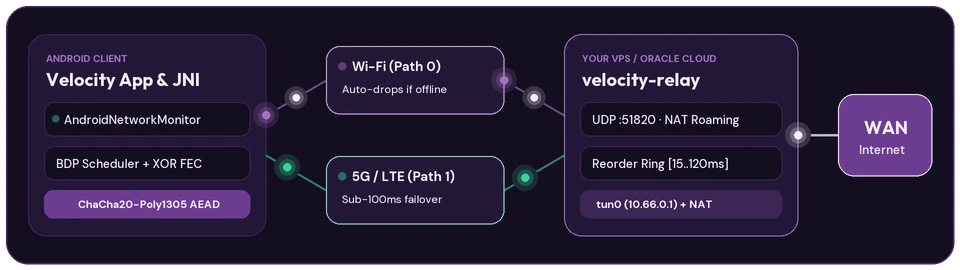

<div align="center">



<br />

[](native/)
[](composeApp/)
[](native/velocity-proto/)
[](server/)

<br />


</div>

---

## Why Velocity

Most VPNs and mobile devices force you onto **either** Wi-Fi **or** Cellular—leaving you stalled on broken cafe Wi-Fi with zero internet, dropping calls during handoffs, or wasting one fast connection completely.

**Velocity** bonds Wi-Fi and Cellular (5G/LTE) simultaneously over a lightweight encrypted UDP tunnel (`VL01`) to a **private relay server you host and control**.

- **Smart Network Intelligence:** Continuously probes each physical radio (`NET_CAPABILITY_VALIDATED` + bound per-interface DNS reachability) *before* and *during* bonding. If Wi-Fi connects with no internet or hits a captive portal, Velocity excludes it cleanly, routes over Cellular, and rejoins automatically once internet returns.
- **Minimalist Obsidian & Liquid Glass UI:** Distraction-free 3-tab layout (`Bond`, `Relays`, `Settings`), optical backdrop-refractive floating dock (`#container-glass` displacement + Gaussian blur + specular rim highlights), smooth swipeable `HorizontalPager`, native haptics, and `Reduce motion` / `Reduce transparency` support.
- **Zero Vendor Lock-In:** Velocity ships **zero hardcoded relay servers**. Spin up your own relay in under 2 minutes on any Ubuntu/Debian VPS, Docker host, home Linux box, or **Oracle Cloud Always Free ARM64 VM (10 TB/month free egress)** and connect with a single `velocity://` invite link.

---

## Interface Gallery

<table>
  <tr>
    <td align="center" width="33%">
      <strong>Obsidian (Dark Mode)</strong><br />
      <sub>Restrained `#140E20` canvas · `#6C3C91` hero orb</sub>
      <br /><br />
      
    </td>
    <td align="center" width="33%">
      <strong>Frost Lilac (Light Mode)</strong><br />
      <sub>Active Wi-Fi + 5G throughput &amp; quota bar</sub>
      <br /><br />
      
    </td>
    <td align="center" width="33%">
      <strong>Smart No-Internet Guard</strong><br />
      <sub>Detects broken Wi-Fi &amp; isolates over 5G</sub>
      <br /><br />
      
    </td>
  </tr>
  <tr>
    <td align="center" width="50%" colspan="1">
      <strong>Self-Hosted Relays</strong><br />
      <sub>Paste `velocity://` links, ping live RTT, inspect egress quota</sub>
      <br /><br />
      
    </td>
    <td align="center" width="50%" colspan="2">
      <strong>Settings &amp; Liquid Glass Dock</strong><br />
      <sub>Optical `#container-glass` navbar refracting cards underneath</sub>
      <br /><br />
      
    </td>
  </tr>
</table>

---

## How Multipath Bonding Works

<div align="center">
  
</div>

| Mode | In App | Under the Hood |
| :--- | :--- | :--- |
| **Speed** | **Fastest** | Arrival-time-compensated BDP weighted deficit round-robin across Wi-Fi & Cellular (`wifiBiasPercent` tunable). |
| **Low Latency** | **Low Lag** | Routes interactive traffic on the lowest-RTT link with optional XOR Forward Error Correction (`FEC`) or loss-triggered duplication. |
| **Failover** | **Backup** | Keeps primary traffic on Wi-Fi while probing Cellular every `250ms` for instant zero-drop handoff if Wi-Fi fails. |

---

## Set Up Your Own Relay Server

> **Important:** Velocity requires your own Linux relay (`velocity-relay`). Because you host it yourself, all keys, IP routes, and bandwidth belong exclusively to you.

### Prerequisites
- A Linux server with a public IPv4 address (Debian/Ubuntu recommended, `/dev/net/tun` available)
- Open **UDP port `51820`** in your server firewall / cloud security group (and optional **TCP `8080`** for quota JSON status)

### Step 1 — Generate a Strong Pre-Shared Key (PSK)
Run on any Linux/macOS terminal (or Git Bash on Windows):
```bash
openssl rand -hex 32
```
Save the 64-character hex string — you will pass it to both your relay and the Velocity Android app.

---

### Option A — Quickest: Docker Deployment

```bash
docker run -d \
  --name velocity-relay \
  --restart unless-stopped \
  --cap-add=NET_ADMIN \
  --device=/dev/net/tun:/dev/net/tun \
  -p 51820:51820/udp \
  -p 8080:8080/tcp \
  -v velocity-data:/var/lib/velocity-relay \
  -e PSK="REPLACE_WITH_YOUR_64_CHAR_HEX_PSK" \
  -e BIND="0.0.0.0:51820" \
  -e MTU="1380" \
  -e WAN="eth0" \
  -e MONTHLY_LIMIT_GB="10240" \
  ghcr.io/manassoni-2009/velocity-relay:latest
```

<details>
<summary><strong>Or use <code>docker-compose.yml</code> (click to expand)</strong></summary>

```yaml
services:
  velocity-relay:
    image: ghcr.io/manassoni-2009/velocity-relay:latest
    container_name: velocity-relay
    restart: unless-stopped
    cap_add:
      - NET_ADMIN
    devices:
      - /dev/net/tun:/dev/net/tun
    ports:
      - "51820:51820/udp"
      - "8080:8080/tcp"
    volumes:
      - ./velocity-data:/var/lib/velocity-relay
    environment:
      - BIND=0.0.0.0:51820
      - STATUS_BIND=0.0.0.0:8080
      - PSK=REPLACE_WITH_YOUR_64_CHAR_HEX_PSK
      - TUN=tun0
      - TUN_CIDR=10.66.0.1/24
      - MTU=1380
      - WAN=eth0
      - SUBNET=10.66.0.0/24
      - MONTHLY_LIMIT_GB=10240
      - PROVIDER_LABEL=My Private Relay
```

Start with:
```bash
docker compose up -d
```

</details>

---

### Option B — Oracle Cloud Always Free (ARM64 · 10 TB/Month Free)

Velocity includes first-class provisioning scripts in [`server/oci/`](server/oci/README.md) tuned for Oracle Cloud's `VM.Standard.A1.Flex` (**4 OCPUs, 24 GB RAM, 10 TB/month free outbound transfer**):

```bash
# On a fresh Ubuntu 22.04 / 24.04 OCI VM (remember to allow UDP 51820 in OCI Subnet Security List):
git clone https://github.com/ManasSoni-2009/Velocity.git
cd Velocity
sudo PSK="REPLACE_WITH_YOUR_64_CHAR_HEX_PSK" \
  BIND_PORT=51820 \
  MONTHLY_LIMIT_GB=10240 \
  ENFORCE_QUOTA=true \
  bash server/oci/install-oci.sh
```

Or deploy the entire VM + VCN + firewall rules via Terraform from Oracle Cloud Shell:
```bash
cd server/oci
terraform init && terraform apply \
  -var="tenancy_ocid=<your-tenancy-ocid>" \
  -var="compartment_ocid=<your-compartment-ocid>" \
  -var="region=<your-home-region>" \
  -var="ssh_public_key=$(cat ~/.ssh/id_rsa.pub)"

# Print your ready-to-paste phone invite link:
terraform output -raw velocity_invite_uri
```

---

### Option C — Bare-Metal Linux Binary + Systemd Example

1. **Build the relay on your Linux server** (Rust `1.80+`):
   ```bash
   cargo build --manifest-path server/Cargo.toml --release --bin velocity-relay
   sudo cp server/target/release/velocity-relay /usr/local/bin/
   ```
2. **Enable IP forwarding, NAT masquerade, and open UDP `51820`** (replace `eth0` if your WAN interface is `ens3` or `enp0s6` — check with `ip route show default`):
   ```bash
   sudo sysctl -w net.ipv4.ip_forward=1
   sudo sysctl -w net.ipv4.conf.all.rp_filter=0
   sudo iptables -t nat -A POSTROUTING -s 10.66.0.0/24 -o eth0 -j MASQUERADE
   sudo iptables -A FORWARD -i tun0 -o eth0 -j ACCEPT
   sudo iptables -A FORWARD -i eth0 -o tun0 -m state --state RELATED,ESTABLISHED -j ACCEPT
   sudo iptables -t mangle -A FORWARD -p tcp --tcp-flags SYN,RST SYN -j TCPMSS --clamp-mtu-to-pmtu
   sudo ufw allow 51820/udp || true
   ```
3. **Run directly (passing `--public-host` prints your exact `velocity://` invite link on startup):**
   ```bash
   sudo velocity-relay \
     --bind 0.0.0.0:51820 \
     --psk "REPLACE_WITH_YOUR_64_CHAR_HEX_PSK" \
     --tun tun0 \
     --tun-cidr 10.66.0.1/24 \
     --mtu 1380 \
     --wan eth0 \
     --public-host YOUR_SERVER_PUBLIC_IP
   ```

---

### Step 3 — Import Into the Velocity Android App

Build your invite URI in the exact format parsed by [`ServerUriCodec`](composeApp/src/commonMain/kotlin/com/velocity/app/domain/ServerUriCodec.kt):

```text
velocity://<64-char-psk>@<SERVER_IP_OR_HOST>:51820?name=My+Relay&region=Custom&mtu=1380
```

Then inside the app:
1. Open **Relays → + Add**.
2. Choose **Paste Link** and paste your `velocity://...` URI (or pick **Manual** and enter Host, Port `51820`, and Key).
3. Tap **Ping** to verify real ChaCha20-Poly1305 encrypted reachability over Wi-Fi & Cellular.
4. Return to **Bond** and tap the central orb!

<details>
<summary><strong>Troubleshooting Checklist (no handshake or no internet after connecting)</strong></summary>

- **UDP `51820` blocked:** Cloud providers (AWS, Oracle Cloud, GCP, Azure, Hetzner Firewall) block inbound UDP by default in the cloud dashboard *and* often have host `iptables` `REJECT` rules. Ensure UDP `51820` is allowed at **both** layers.
- **Wrong `WAN` interface name:** Run `ip route get 1.1.1.1` on your server and pass `--wan <iface>` (or `-e WAN=<iface>` in Docker) matching `dev <iface>`.
- **Asymmetric routing dropped by kernel:** Ensure `net.ipv4.conf.all.rp_filter=0` and `net.ipv4.ip_forward=1` are active.

</details>

---

## Local Build, Test & Phone Deploy Loop

Velocity includes a self-contained PowerShell developer loop ([`scripts/dev-loop.ps1`](scripts/dev-loop.ps1)) that keeps all NDK, Cargo, Rustup, Gradle, and temp caches isolated inside `.tools/` without bloating `C:\`:

```powershell
# Run Rust tests + NDK (.so) cross-compile + Android/Desktop tests + APK build:
powershell -ExecutionPolicy Bypass -File .\scripts\dev-loop.ps1

# Fast incremental test, build & deploy directly to a USB-debugging Android phone:
powershell -ExecutionPolicy Bypass -File .\scripts\dev-loop.ps1 -SkipRust -SkipNdk -Deploy
```

<details>
<summary><strong>Architecture & Protocol Internals (VL01, Reorder Buffer, Native Bridge)</strong></summary>

* **`native/velocity-proto`**: 40-byte binary header (`0x56`, `0x01`), flags (`DATA`, `CONTROL_PROBE`, `KEEPALIVE`, `DUPLICATE`, `FEC_PARITY`, `SPEEDTEST`), 64-bit session ID, TX timestamp (`u32` microseconds), and ChaCha20-Poly1305 AEAD key derivation from PSK + session ID.
* **`native/velocity-core`**: Tokio async multipath scheduler (`BdpRoundRobin`, `LowLatency`, `HotFailover`), sliding-window throughput & EWMA RTT/jitter estimator (`estimator.rs`), adaptive reorder ring buffer (`15ms..120ms`), concurrent speedtest echo engine (`speedtest.rs`), and 200ms watchdog emitting real-time camelCase JSON telemetry (`telemetry.rs`).
* **`native/velocity-jni`**: Safe FD duplication (`libc::dup`), JNI callback bridge (`onStateChanged`, `onTelemetryUpdate`), live tuning updates (`nativeUpdateConfig`), encrypted relay probes (`nativeProbeServerJson`), and dual-socket speedtest (`nativeRunMultipathSpeedTestJson`).
* **`composeApp`**: Kotlin Multiplatform (Android + Desktop JVM), `AndroidNetworkMonitor` (active DNS reachability probes bound to physical `Network`s), `MultiNetworkManager` (live failover & auto-rejoin), `VelocityVpnService`, and Material 3 + custom Liquid Glass UI.

</details>

---

## License

Licensed under the [MIT License](LICENSE).
